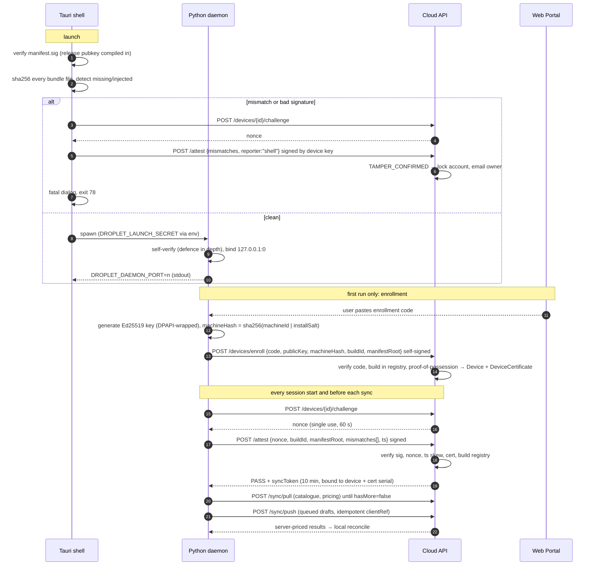
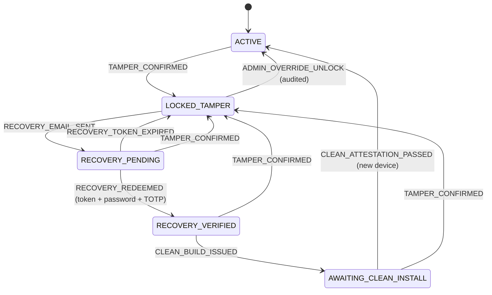

# DROPLET: system architecture

DROPLET is a B2B trade portal with two clients over one cloud backend:

| Component | Tech | Location | Responsibility |
|---|---|---|---|
| **Web Portal** | React 18, TypeScript, Tailwind | `apps/web` | Trade buyer / rep / admin UI, desktop download, security lock and recovery screens |
| **Cloud API** | Node 22, Fastify, Prisma, PostgreSQL | `apps/cloud-api` | System of record: accounts, pricing, orders, device trust, tamper tripwire |
| **Desktop shell** | Tauri 2 (Rust) | `apps/desktop/src-tauri` | OS-code-signed launcher: pre-launch integrity gate, daemon supervisor, UI↔daemon proxy |
| **Local engine** | Python 3.12, FastAPI, SQLite | `apps/desktop/daemon` | "Listen server" on 127.0.0.1: catalogue, SKU lookup, drafts at 0 ms; explicit sync |

## 1. Trust boundaries

```
┌──────────── user machine ─────────────────────────────┐        ┌──────────── DROPLET cloud ───────────┐
│                                                       │        │                                      │
│  Tauri shell (Authenticode / notarized)               │  TLS   │  Cloud API (Fastify)                 │
│   ├─ integrity gate (manifest sig + sha256 walk) ─────┼────────┼─▶ /v1/attest   ← device signature    │
│   ├─ spawns daemon w/ per-launch secret (env)         │        │   /v1/sync/*   ← sync token (10 min) │
│   └─ webview UI ──invoke──▶ daemon_request proxy      │        │   /v1/devices/enroll                 │
│                                │                      │        │   /v1/desktop/download-grants        │
│  Python daemon  ◀──127.0.0.1───┘                      │        │   /v1/security/recovery/*            │
│   ├─ SQLite cache (catalogue, contract prices, drafts)│        │                                      │
│   └─ device key: Ed25519, DPAPI-wrapped file ─────────┼────────┼─▶ PostgreSQL (Prisma schema)         │
└───────────────────────────────────────────────────────┘        └──────────────────────────────────────┘
          ▲                                                                      ▲
          │ signed, single-use, 5-min URL + enrollment code                      │ session cookie
          └──────────────────────────── Web Portal (browser) ────────────────────┘
```

What each party trusts:

* **The cloud trusts no client.** Every price is re-resolved server-side, every order is idempotent on `(account, clientRef)`, every sync call re-checks account state, device status and certificate live.
* **The device key** proves *which* install is talking. It is generated at enrollment, stored only as a DPAPI-wrapped file (`%LOCALAPPDATA%\com.droplet.desktop\device.key`, readable by this Windows user only; the shell and daemon share the format), and is bound to a cloud-issued `DeviceCertificate` that the cloud can revoke.
* **The release key** (Ed25519, offline/HSM) proves *what* is installed. CI signs every bundle's manifest with it; its public half is compiled into the shell and stamped into the daemon.

## 2. Web authentication gate

* Public routes: `/` (landing), `/login`, `/apply`, `/pending`, `/security/recover`. Everything under `/app` requires a session; a signed-in user opening `/` or `/login` lands straight in the portal.
* `POST /v1/auth/login`: scrypt password check (constant-time path for unknown emails), then TOTP if the user has a confirmed authenticator. 8 failures per IP+email per 15 min → 429.
* Sessions are opaque 256-bit tokens in an `HttpOnly; SameSite=Lax` cookie (12 h); only the sha256 is stored. Every state-changing request must come from the portal origin (`assertSameOrigin`).
* Unapproved accounts (`PENDING_APPROVAL`) and security-locked accounts never receive a session.
* Two-step verification is mandatory before a trade user can obtain the desktop installer, because tamper recovery depends on it.

### Admin portal and onboarding

* One install per business (single tenant). A fresh install has no administrator; a one-time
  **setup link** (72 h, hash stored in `BusinessProfile`) creates the first ADMIN. See [ONBOARDING.md](ONBOARDING.md).
* Staff (`ADMIN`, `SALES_REP`) use `/admin`. `requireStaff` enforces role and a confirmed
  authenticator on every admin call (`MFA_SETUP_REQUIRED` until enrolled). Account managers are
  scoped to their `RepAssignment`s; catalogue, pricing, team, security and settings are admin-only.
* Staff and additional buyers join through single-use **invitations** (`Invite`, 7 days, hash only).
* Every admin action writes `AuditLog`; status changes email the affected customer.
* Desktop staff sign-in goes through the shell's `cloud_request` command: the session cookie is
  held in Rust memory only and never reaches the webview or disk.

## 3. Distribution: no public download

1. A trade account signs up and is `PENDING_APPROVAL`. Admin approval sets `APPROVED`.
2. In the portal, **Get signed installer** calls `POST /v1/desktop/download-grants` (requires a session; locked or unapproved accounts get 403/423).
3. The API creates a `DownloadGrant` (15 min) and returns:
   * `url`: `/v1/desktop/download/<dl.HMAC token>`, valid 5 min, **redeemable once** (`usedAt` is set atomically)
   * `sha256` of the signed installer, for out-of-band verification
   * `enrollmentCode`: an HMAC token binding `{userId, grantId}`, valid 10 min
4. Redeeming the URL 302s to a 60-second presigned URL on a **private** bucket. The bucket is never public.

## 4. Enrollment and the attestation handshake



### Attestation verdicts (`apps/cloud-api/src/routes/devices.ts`)

| Condition | Verdict | Effect |
|---|---|---|
| Signature invalid | `BAD_SIGNATURE` | 401, logged. **Never locks:** anyone can send garbage, and an unauthenticated report must not be able to lock an account. |
| Nonce unknown, reused or expired | `REPLAY` | 401, logged |
| `ts` outside ±120 s | n/a | 401 |
| Device quarantined or certificate revoked | n/a | 403 `DEVICE_REVOKED` |
| Build in registry but revoked | `REVOKED_BUILD` | 426, update required. No lock (it's ours, just old). |
| `manifestRoot` not in registry for `buildId` | `UNKNOWN_BUILD` | **Tripwire** |
| `mismatches[]` non-empty | `TAMPER` | **Tripwire** |
| Otherwise | `PASS` | Sync token issued. If the account is `AWAITING_CLEAN_INSTALL` and this device was enrolled after the incident, the account unlocks. |

## 5. Sync protocol

Desktop and cloud never free-sync. Reconciliation happens only when the user triggers it or at session start, and always behind a fresh attestation.

* **Pull** (`/v1/sync/pull`): catalogue rows carrying this account's price breaks, cursor over a global monotonic `syncVersion` (writes that change prices or stock must bump it). Pages of ≤2000 rows; the daemon commits rows **and** cursor in one SQLite transaction, so an interrupted sync resumes exactly.
* **Push** (`/v1/sync/push`): drafts marked `QUEUED` locally are sent with a client-generated UUID `clientRef`. The server:
  1. returns the existing order on duplicate `clientRef` (safe retries)
  2. rejects unknown/inactive SKUs per draft
  3. re-resolves every unit price (contract → tier → list); client prices are display hints only
  4. routes over-credit orders to `PENDING_APPROVAL` for the assigned rep
* **Snapshot** (`/v1/sync/snapshot`): the same dashboard read model the web portal uses (orders, credit, statement, quotes), cached in SQLite so the desktop dashboard works offline.
* **Conflict rule:** the cloud is authoritative for catalogue, pricing and order state. Local drafts are owned by the device until pushed; once pushed they become read-only mirrors.

## 6. Integrity pipeline

**Build (CI):**
1. `build_manifest.py stamp` writes the release public key into `integrity.py`.
2. PyInstaller builds the daemon (onedir).
3. `build_manifest.py manifest` hashes every file, writes canonical `manifest.json`, signs it (HSM in production) → `manifest.sig`, prints `{buildId, manifestRoot, manifestSig}`.
4. CI registers that row in `DesktopRelease`.
5. Tauri bundles the daemon as a resource; the shell is built with `DROPLET_RELEASE_PUBKEY`; the installer is Authenticode-signed (Windows) / notarized with hardened runtime (macOS).

**Run:** the shell (`integrity.rs`) and daemon (`integrity.py`) run the same check:
signature valid, every listed file's sha256 matches, nothing missing, **nothing extra** (an injected `sitecustomize.py`, `.pth` or side-loaded DLL counts as a mismatch), no symlinks. The shell re-runs it every 15 minutes.

**Canonical JSON** is the contract between three signers/verifiers (TS, Python, Rust): sorted keys, compact separators, raw UTF-8, integers only. Tested in `tests/test_integrity.py`.

### What this does not guarantee

Client-side self-checks raise the cost of tampering; they do not make it impossible. An attacker with local admin can patch the checker *and* the reporter and replay a plausible PASS. The design assumes that and leans on controls the attacker can't forge from the client:

* **OS code signing** of the shell. Patching it breaks Authenticode/notarization; SmartScreen/Gatekeeper and EDR flag it.
* **Server-side `manifestRoot` registry.** A rebuilt or re-signed fork reports a root the cloud has never published.
* **Nonce + device key.** A captured PASS can't be replayed, and the key is useless off-device once it is in a TPM/Secure Enclave (recommended hardening; see `device.py`).
* **Short-lived, live-revalidated sync tokens.** A lock takes effect on the next request.
* **Server-authoritative pricing and credit.** Even a fully compromised client cannot buy below contract price or past credit limit.

Recommended next layers: TPM-backed keys with key attestation (Windows `NCRYPT_PCP`, Apple App Attest/DeviceCheck on macOS), Windows `WinVerifyTrust` self-check in the shell, rate limiting on `/attest` and `/recovery/*` (e.g. `@fastify/rate-limit`), and anomaly scoring on attestation history.

## 7. Tamper → lockout → recovery state machine

Source of truth: `apps/cloud-api/src/security/stateMachine.ts` (pure, unit-tested). Executor: `security/tripwire.ts`.



| Transition | Effects (one DB transaction, row-locked on the account) |
|---|---|
| `TAMPER_CONFIRMED` | revoke all web sessions · invalidate sync (live check) · quarantine device · open `SecurityIncident` · mint one recovery token per account owner (only sha256 stored) · audit |
| *after commit* | send alert email(s) → `RECOVERY_EMAIL_SENT`. If delivery fails the account **stays locked** (fail-safe); the lock screen offers resend. |
| `RECOVERY_REDEEMED` | requires unexpired, unused token **and** password **and** TOTP; burns sibling tokens · revoke certificates of all quarantined devices |
| `CLEAN_BUILD_ISSUED` | new `DownloadGrant(reason=RECOVERY)` for the latest non-revoked build; only that build may enroll |
| `CLEAN_ATTESTATION_PASSED` | only from a device **enrolled after the incident** that is not quarantined (a clean install regenerates `installSalt` → new `machineHash` + keypair = new device) · resolve incident |

Every state other than `ACTIVE` blocks portal sessions (`423 ACCOUNT_SECURITY_LOCK`), ordering, downloads and desktop sync. A cron sweeper (`sweepExpiredRecoveries`) moves lapsed `RECOVERY_PENDING` accounts back to `LOCKED_TAMPER`.

### Operational caveats

* **False positives.** Antivirus quarantining a DLL or a half-applied update both look like tamper. Ship updates atomically (side-by-side install directory, swap on success) and give support the `ADMIN_OVERRIDE_UNLOCK` path. The incident view shows the exact file list (`Attestation.mismatches`).
* **Blast radius.** A tamper on one buyer's machine locks the whole trade account, as specified. Consider a per-user lock if accounts grow to many buyers.
* **Staff devices** (reps/admins have no trade account) are quarantined and rejected but not routed through this machine; their lockout belongs in the IdP.

## 8. Data model

`apps/cloud-api/prisma/schema.prisma`. Highlights:

* Money is `BigInt` minor units everywhere.
* Price resolution: `AccountPrice` (account × product × minQty × validity window) → `TierPrice` → `Product.listMinor`.
* `TradeAccount.securityState` is written only by the state machine executor.
* Device trust: `DesktopRelease` (registry) → `DownloadGrant` → `Device` (pubkey, machineHash) → `DeviceCertificate` (revocable) → `Attestation` (forensic log, full signed payload) → `SecurityIncident` → `RecoveryToken` (hash only).
* `AuditLog` captures every security transition, order push, enrollment and download.
